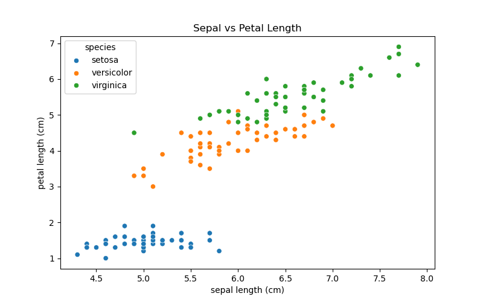
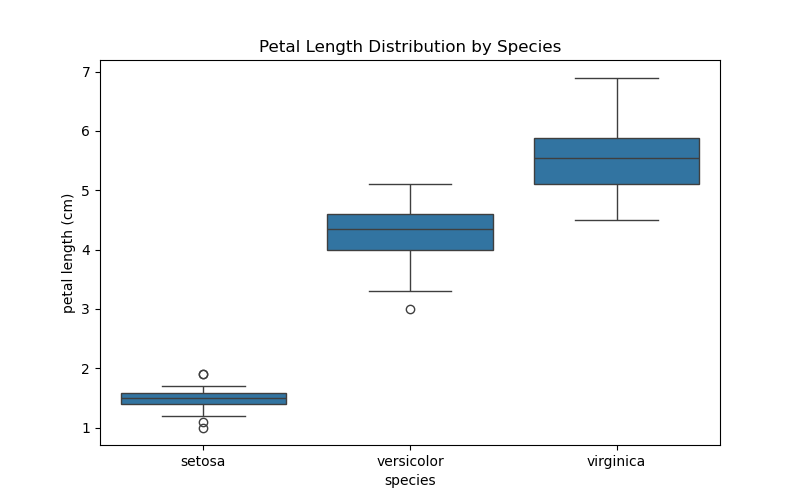

# My Data Science Portfolio

## About Me
Name: Dong Yushuo
I am a Master student in Data Science (Computational Linguistics) at University of Macau.

### Technical Skills
Python, Pandas, NumPy, Matplotlib, Seaborn, Jupyter Notebook, Exploratory Data Analysis

## Project: Exploratory Analysis of Iris Dataset
### Project Research Question
Can we distinguish three different iris flower species using their sepal and petal size measurements?

### Visualization Results & Explanation

> This scatter plot shows the relationship between sepal length and petal length for three iris species. Setosa is clearly separated from the other two species.

> This boxplot compares petal length distribution across three species. It demonstrates that setosa has the smallest petal length, while virginica has the largest.

### Project Conclusion
The analysis shows that setosa can be easily separated from the other two iris species by petal length, while versicolor and virginica have overlapping features and are harder to distinguish.

### Project Repository Link
https://github.com/Dong-123-12/data-science-project

### Project Status
Completed
